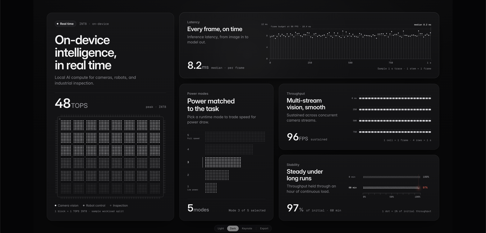
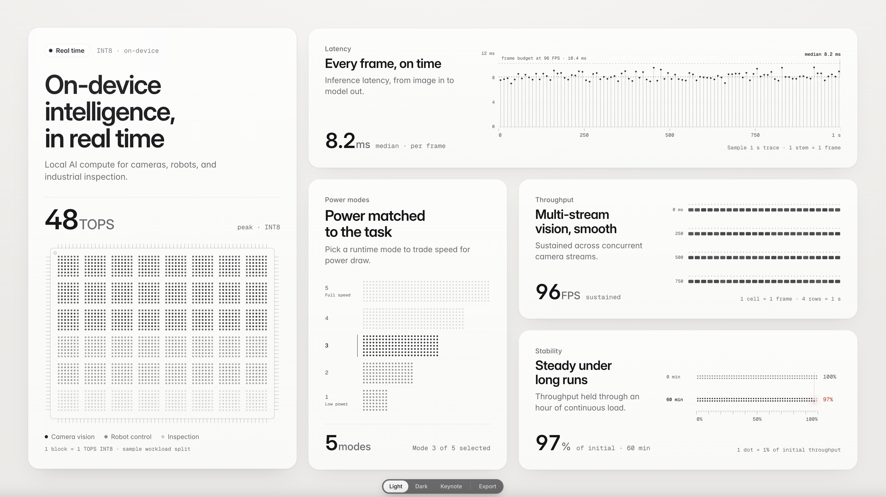

# bento-slide skill

Drop-in package for the bento-slide playbook (name in `SKILL.md` frontmatter: `bento-slide`).

## Examples

Dark and Light themes (inline — no click-through needed):

Source: [@Yur1freedom on X](https://x.com/Yur1freedom/status/2115995906197823999)

## What's in here
| Path | Role |
|---|---|
| `SKILL.md` | Full playbook (layouts, recipes, export, variation rules) |
| `SLIDES.md` | Slide registry — read before picking layout/charts |
| `TECH-NOTES.md` | Implementation notes |
| `SUMMARY.md` | Short overview |
| `bento-shell.html` + `viz/` + `fonts/` + `export/` | Dev shell + modules |
| `build/build.mjs` | Inline → one offline HTML (`node build/build.mjs`) |
| `build/export.mjs` | Headless batch export / QA screenshots |
| `dist/bento-slide.html` | Built offline proof |
| `bento-proof.html` | Reference slide |
| `qa/*.png` | Quality-floor captures (study `*-zoom-*.png`) |
| `examples/` | Example renders shown above |

## Quick start
1. Read `SKILL.md` §1–§5 and `SLIDES.md`.
2. Edit shell or copy modules into a new slide folder.
3. `node build/build.mjs` → offline HTML in `dist/`.
4. In the browser: **Export** (or `E`) for PNG / PDF / `.pptx`.

